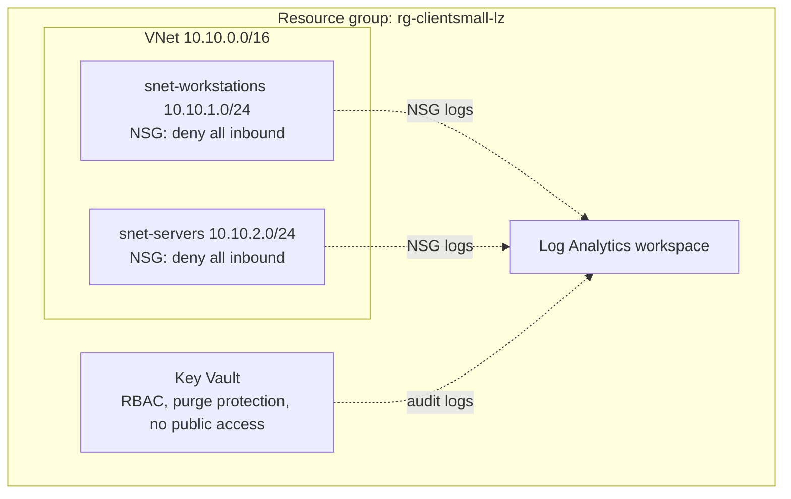
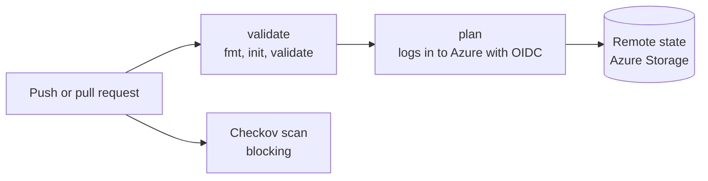

# Azure Secure Landing Zone (Terraform)

A small, repeatable Azure baseline built with Terraform and checked by a CI pipeline on every change. It is modeled on how an MSP would stand up the same secure foundation for many clients: one set of modules, one variables file per client.

## What it deploys

Per client environment (currently `client-small`):

- Resource group
- Virtual network with two subnets (workstations, servers)
- A network security group on each subnet with an explicit deny-all-inbound rule
- Log Analytics workspace
- Diagnostic settings sending NSG events and Key Vault audit logs to that workspace
- Key Vault using Azure RBAC, with purge protection on and public network access disabled

## Architecture



## CI pipeline



- **validate:** `terraform fmt -check`, `init -backend=false`, and `validate`
- **checkov:** static security scan of the Terraform; the build fails on any finding that is not explicitly skipped
- **plan:** `terraform plan` against the real subscription. GitHub authenticates to Azure with OIDC (a short-lived token tied to this repo), so no passwords or client secrets are stored anywhere

## Repository layout

```
.
├── main.tf, variables.tf, providers.tf, backend.tf
├── modules/
│   ├── network/     VNet, subnets, NSGs, subnet associations
│   ├── logging/     Log Analytics workspace
│   └── security/    Key Vault and role assignment
├── envs/
│   └── client-small.tfvars
└── .github/workflows/terraform.yml
```

## Security decisions and Checkov findings

The first scan flagged five findings, all on the Key Vault. Four were fixed and one was accepted with a documented reason.

| Check | Finding | Decision |
|---|---|---|
| CKV_AZURE_42 | Key Vault not recoverable | Fixed: purge protection enabled |
| CKV_AZURE_110 | Purge protection off | Fixed: enabled |
| CKV_AZURE_189 | Public network access enabled | Fixed: disabled |
| CKV_AZURE_109 | No firewall default-deny | Fixed: network ACL default action set to Deny |
| CKV2_AZURE_32 | No private endpoint | Accepted for now (inline skip with reason). The vault has no public access and holds no secrets yet. A private endpoint and private DNS zone are on the roadmap |

Trade-offs worth knowing:

- Purge protection cannot be turned off once enabled. After a destroy, the vault stays soft-deleted for 7 days, and applying again recovers it.
- With public access disabled, secrets cannot be read or written from outside the VNet until a private endpoint exists.

## How to run it

Prerequisites: Terraform, Azure CLI, and an Azure subscription.

1. Create the remote state storage once (names must be globally unique):

   ```bash
   az group create --name rg-tfstate-lz --location eastus
   az storage account create --name <unique-name> --resource-group rg-tfstate-lz \
     --location eastus --sku Standard_LRS --min-tls-version TLS1_2 --allow-blob-public-access false
   az storage container create --name tfstate --account-name <unique-name> --auth-mode key
   ```

   Give your account the Storage Blob Data Contributor role on that storage account, then put the account name in `backend.tf`.

2. Deploy:

   ```bash
   az login
   export ARM_SUBSCRIPTION_ID=$(az account show --query id -o tsv)
   terraform init
   terraform plan  -var-file=envs/client-small.tfvars
   terraform apply -var-file=envs/client-small.tfvars
   ```

3. Tear down when you are finished experimenting:

   ```bash
   terraform destroy -var-file=envs/client-small.tfvars
   ```

## GitHub to Azure setup (OIDC)

The workflow needs three repository secrets, each holding only a GUID with no label or quotes: `AZURE_CLIENT_ID`, `AZURE_TENANT_ID`, and `AZURE_SUBSCRIPTION_ID`. The Entra app registration has federated credentials for this repo and is limited to Reader on the subscription plus Storage Blob Data Contributor on the state storage account.

## Troubleshooting notes

- **AADSTS900023 (invalid tenant identifier):** a secret contained the label text (for example `AZURE_TENANT_ID=...`) instead of only the GUID.
- **AADSTS700213 (no matching federated identity record):** GitHub now includes numeric owner and repo IDs in the OIDC subject (`repo:OWNER@<id>/REPO@<id>:...`). The federated credential subject in Entra must match the subject shown in the error exactly.
- **SubscriptionNotFound when creating storage on a new subscription:** register the resource provider (`az provider register --namespace Microsoft.Storage --wait`) and retry.

## Cost

NSGs, VNets, subnets, and diagnostic settings are free. The state storage account, Key Vault, and Log Analytics workspace cost pennies at lab volume. A monthly budget alert is configured on the subscription. Hourly-billed resources such as VPN gateways should be deployed, validated, and destroyed.

## Roadmap

- Second environment (`client-large`) with its own state file
- Conditional Access baseline as code
- Key Vault private endpoint and private DNS zone
- VPN gateway module for site-to-site connectivity
